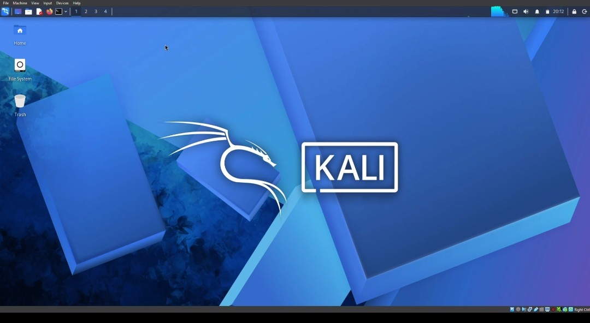
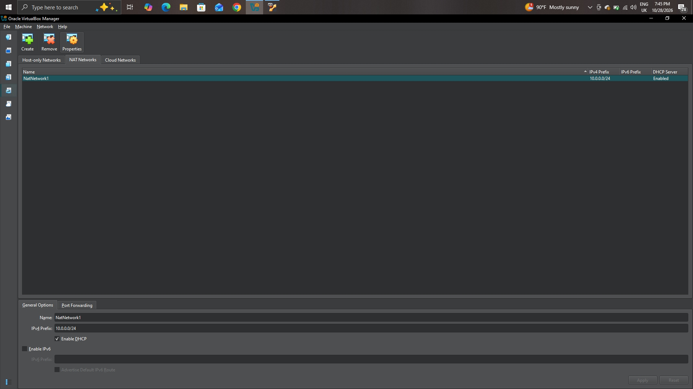
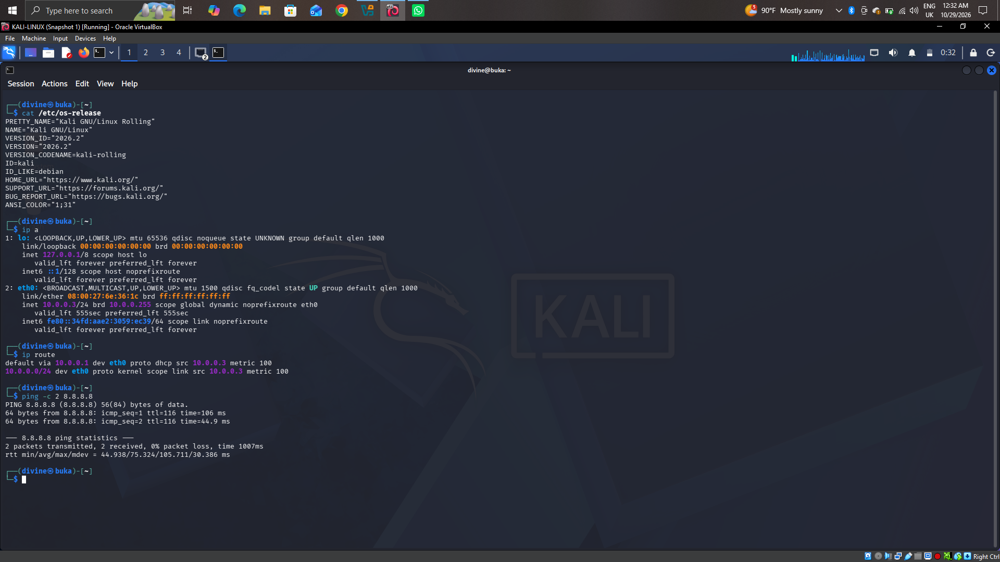

# Cybersecurity Lab Environment VM Setup


This is the first lab of my Cybersecurity Internship at Networkwalks, guided by my instructor Waqas Karim, CCIE. The goal of the lab is a safe, isolated place to practise security works. This repo documents how I built it; one Kali Linux machine on its own private network, with room to add target machines later.

## Laboratory Overview

| Item | Value |
|---|---|
| Host | Windows 10 Pro, Intel Core i7 (2 cores), 16 GB RAM |
| Hypervisor | Oracle VirtualBox 7.2.22 |
| Guest | Kali Linux 2026.2 (rolling), Xfce desktop |
| VM name | `KALI-LINUX` |
| VM memory | 8 GB |
| Lab network | NAT Network `NatNetwork1`, `10.0.0.0/24`, DHCP on, IPv6 off |
| Kali address | `10.0.0.3/24` from DHCP, gateway `10.0.0.1` |

## How it is laid out

```
My Windows 10 host
└── VirtualBox
    └── NAT Network "NatNetwork1"       10.0.0.0/24
        ├── KALI-LINUX (attacker)       10.0.0.3, built in this project
        └── target VMs                  We didn't target anything yet, just to setup
            │
            └── traffic going out is NATed through the host to the internet
```

Machines on this network can talk to each other and reach the internet. Nothing outside my host can start a connection into the lab, because I did not set up any port forwarding.

## Settings I used

| Area | Setting |
|---|---|
| Guest OS type | Linux / Debian (64-bit) |
| Base memory | 8192 MB |
| Chipset | PIIX3, BIOS mode (UEFI off) |
| Boot order | Optical, then Hard Disk |
| Acceleration | Hardware virtualization with Nested Paging enabled |
| Pointing device | USB Tablet |
| Hardware clock | UTC |
| Display | VMSVGA, 16 MB video memory, 3D acceleration off |
| Network adapter | Adapter 1, NAT Network `NatNetwork1`, Intel PRO/1000 MT Desktop (82540EM), promiscuous mode Deny |

**NAT Network:** name `NatNetwork1`, IPv4 prefix `10.0.0.0/24`, DHCP server enabled, IPv6 disabled.

**Inside Kali:** the `Wired connection 1` profile is set to Automatic (DHCP), and I added `8.8.8.8` as an extra DNS server.

## How I built it

1. **Created the NAT Network.** In VirtualBox: File > Tools > Network > NAT Networks > Create. Name `NatNetwork1`, prefix `10.0.0.0/24`, DHCP on, IPv6 off.



2. **Created the VM.** I already had a Linux virtual machine file from earlier work, so instead of installing Kali from an ISO I reused that same file to create a new VM called `KALI-LINUX`. I set the type to Linux / Debian (64-bit) and gave it 8192 MB of RAM.


3. **Checked virtualization.** Under System > Acceleration, hardware virtualization and Nested Paging were enabled. If a VM refuses to start, VT-x is usually switched off in the BIOS.
4. **Connected Kali to the lab network.** Settings > Network > Adapter 1 > Attached to NAT Network > `NatNetwork1`.
5. **Checked the addressing inside Kali.** The connection is on Automatic (DHCP), and `8.8.8.8` is added as an extra DNS server.
6. **Ran my checks**.

## What I learnt While setting it up

**NAT Network, not plain NAT.** Think of plain NAT as everyone living in their own locked house with a private door to the road: they can go out, but they cannot visit each other. A NAT Network is like a gated estate. Everyone inside can visit each other, residents can go out through the gate, and strangers on the road cannot just walk in. A lab with several machines needs the estate.

**Not bridged.** Bridged mode puts my lab machines straight onto the real network. I do not want my scans anywhere near devices I do not own except legally authorised by the owner.

**Not host-only.** Host-only has no internet, which makes updating Kali and installing tools a hard and a pain.

**DHCP instead of a fixed address.** Less to set up. The downside is that the address can change, so I check `ip a` before pointing a tool at a machine instead of trusting an old note.

**Promiscuous mode on Deny.** The adapter only needs its own traffic for now. I will switch it to `Allow VMs` when I start capturing traffic between machines in Wireshark.

**8 GB of RAM.** My host has 16 GB, so I gave Kali half.

## Verifying the connection 

Everything below was run inside Kali.

| Check | Command | What I expected | What I got |
|---|---|---|---|
| OS version | `cat /etc/os-release` | Kali GNU/Linux Rolling | Kali 2026.2 |
| Address on the lab subnet | `ip a` | An address in `10.0.0.0/24` | `10.0.0.3/24` on `eth0` |
| Default gateway | `ip route` | A default route through the lab gateway | Default via `10.0.0.1` |
| Internet by IP | `ping -c 2 8.8.8.8` | No packet loss | 2 of 2 received, average 75 ms |

```
$ ip a
2: eth0: <BROADCAST,MULTICAST,UP,LOWER_UP> mtu 1500 ... state UP
    link/ether 08:00:27:6e:36:1c brd ff:ff:ff:ff:ff:ff
    inet 10.0.0.3/24 brd 10.0.0.255 scope global dynamic noprefixroute eth0

$ ip route
default via 10.0.0.1 dev eth0 proto dhcp src 10.0.0.3 metric 100
10.0.0.0/24 dev eth0 proto kernel scope link src 10.0.0.3 metric 100

$ ping -c 2 8.8.8.8
2 packets transmitted, 2 received, 0% packet loss, time 1007ms
rtt min/avg/max/mdev = 44.938/75.324/105.711/30.386 ms
```

a
## What went wrong

**1. I created the NAT Network with the wrong prefix.**
My first NAT Network, `NatNetwork`, came out as `10.0.2.0/24` instead of `10.0.0.0/24`. I deleted it and created `NatNetwork1` with the right range. The lesson was that the VM's network adapter does not follow the change. It still pointed at the old name until I selected `NatNetwork1` again.

**2. I labelled the VM as Ubuntu instead of Debian.**
VirtualBox showed Kali as "Ubuntu (64-bit)" because I picked the wrong OS type. I fixed it under Settings > General (OS Distribution: Debian, OS Version: Debian (64-bit)) with the VM powered off. I had made the same mistake on my earlier VMs, so I went back and corrected those too. It mostly changes the label and VirtualBox's default hardware settings.

## Security & Ethical Use Only

This lab is only for systems I own or have written permission to test. Nothing in it should be pointed at anything else, strictly for education purposes only.


## Tools & Resources 
virtualbox: https://virtualbox.org

Kali Linux: https://kali.org

## Author
Ozaraebuka Ifechukwu Divine 
Cybersecurity Professional B084

LinkedIn: https://www.linkedin.com/in/ozaraebuka-ifechukwu-7a4b06402

## About me

I'm Buka, a Computer Science student at Federal University of Technology Owerri, Nigeria; building the hands-on side of a SOC Analyst path, one documented project at a time.

- **Program:** Cybersecurity Internship, Networkwalks IT Solutions & Training
- **Instructor:** Waqas Karim, CCIE
- **A note on credit:** this lab was set as part of the internship and follows my instructor's brief. The settings, results, screenshots and mistakes written up here come from my own build.
